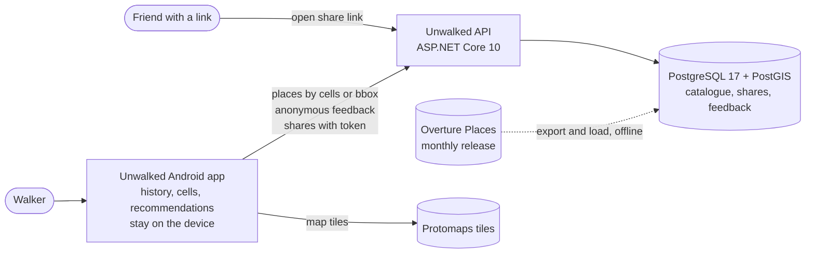
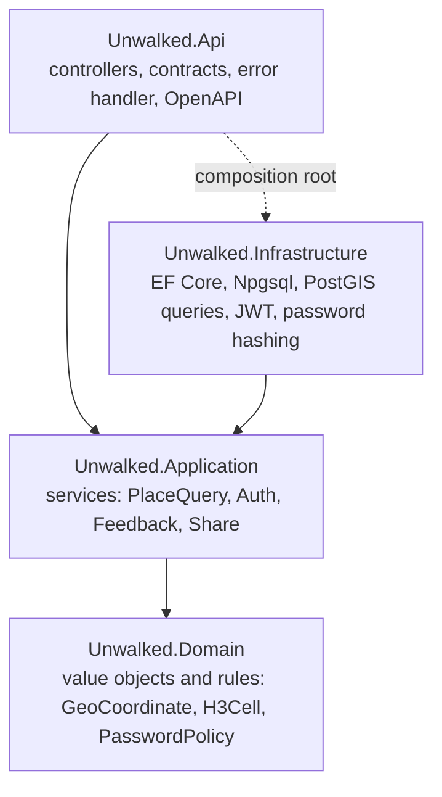
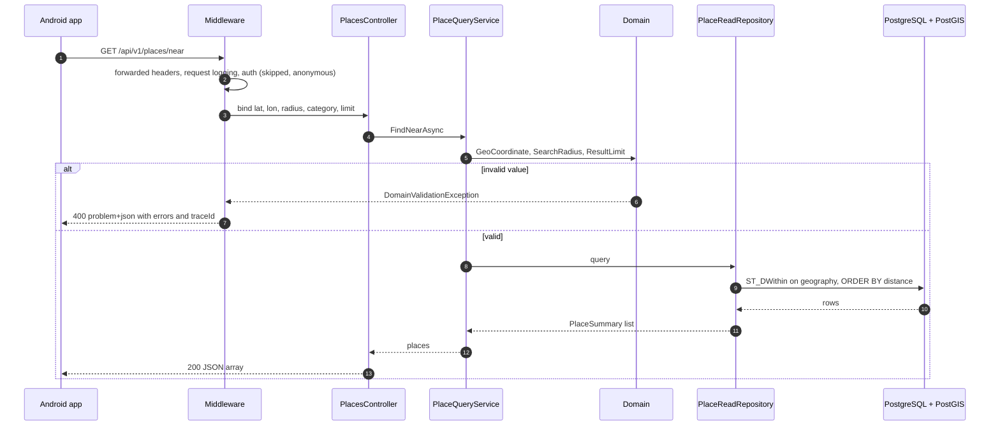
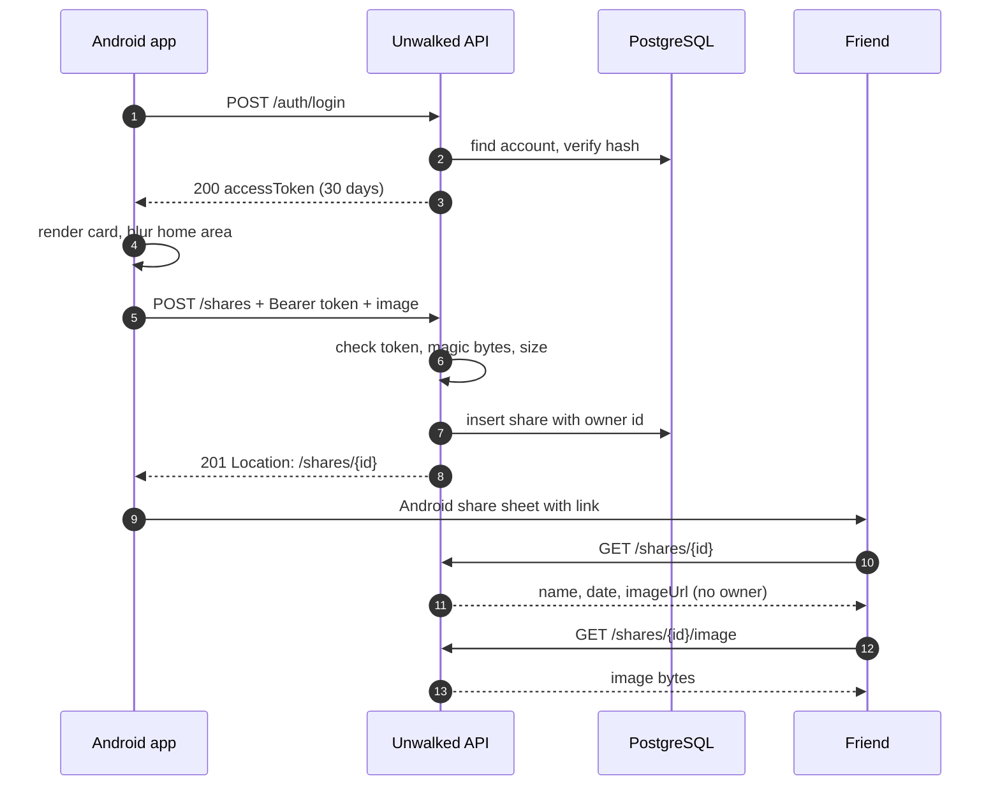

# Architecture

## System context

The phone does the heavy lifting. It records location, detects stays, aggregates them into H3 cells and computes novelty. The API is a thin catalogue and sharing service. It never receives location history.

## Resources

| Resource | Purpose | Auth | Stores personal data |
|---|---|---|---|
| `auth` | Accounts for share owners | None | Email and password hash |
| `places` | Read-only catalogue from Overture Places | None | No |
| `feedback` | Anonymous reactions to recommendations, for the thesis study | None | No, no account id or location |
| `shares` | Public achievement links with a generalised image | Token to create and delete | Owner id, never exposed |

## Inside the API

The code follows a layered layout. Each layer only depends on the ones below it.

Validation lives in the domain. A `GeoCoordinate` cannot be constructed with latitude 95, so every endpoint that takes a point rejects it the same way with the same message.

## Request lifecycle

What happens to `GET /api/v1/places/near?lat=54.6872&lon=25.2797&radius=300`.

## Sharing flow

## Database logins

The API connects as `unwalked_api`, which can read the catalogue and write only feedback, accounts and shares. It cannot change the schema or the catalogue. The [data dictionary](../database/data-dictionary.md) has the full role matrix.
