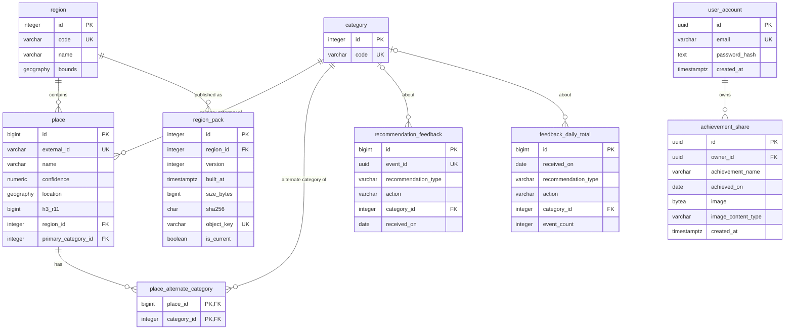

# Data dictionary

Unwalked keeps data in two places. Movement history never leaves the phone. It lives in an on-device Room (SQLite) database. The server runs PostgreSQL 17 with PostGIS 3.5. It stores the shared place catalogue, the downloadable region packs, accounts used only for sharing achievements, and anonymous reactions to recommendations.

The server schema is created by EF Core migrations in `src/Unwalked.Infrastructure/Persistence/Migrations`. The same DDL as a plain SQL script is in [db/schema.sql](../../db/schema.sql).

## Logical schema

## Normalisation

The schema is in third normal form. Every non-key column depends on the whole key and only on it.

| Decision | Why |
|---|---|
| Categories are a reference table | A place has one primary category and any number of alternate ones. Storing codes inline would repeat the same string thousands of times and allow typos. |
| Alternate categories are a separate link table | A list column would break the first normal form. |
| Regions are a reference table | Places and region packs both belong to a region. The region name and bounds are stored once. |
| `recommendation_type` and `action` stay as checked text | They are closed sets fixed by the API contract. A lookup table would add joins and no new facts. The `CHECK` constraints keep them valid. |
| `feedback_daily_total` repeats the shape of `recommendation_feedback` | It is a deliberate summary table, not a copy. Raw rows are moved into it, so each reaction is counted exactly once. |

## Server tables

### region

A city or area for which the catalogue and a region pack are built.

| Column | Type | Null | Description |
|---|---|---|---|
| id | integer identity | no | Primary key |
| code | varchar(32) | no | Stable slug used in URLs and object keys, for example `vilnius`. Unique, lowercase letters, digits and hyphens |
| name | varchar(100) | no | Display name. Must not be blank |
| bounds | geography(polygon, 4326) | no | Area covered by the catalogue |

### region_pack

A built offline package of tiles and places for one region. The phone downloads the current one.

| Column | Type | Null | Description |
|---|---|---|---|
| id | integer identity | no | Primary key |
| region_id | integer | no | Region, `ON DELETE RESTRICT` |
| version | integer | no | Increasing build number, positive, unique per region |
| built_at | timestamptz | no | Build time |
| size_bytes | bigint | no | Download size, positive |
| sha256 | char(64) | no | Lowercase hex checksum the phone verifies after download |
| object_key | varchar(200) | no | Key of the file in object storage. Unique |
| is_current | boolean | no | The pack offered to phones. At most one per region |

### category

Overture Places category codes. Filled by the reference seed.

| Column | Type | Null | Description |
|---|---|---|---|
| id | integer identity | no | Primary key |
| code | varchar(64) | no | Overture code such as `cafe`. Unique, lowercase letters, digits and underscores |

### place

A point of interest from Overture Places (CDLA-Permissive 2.0).

| Column | Type | Null | Description |
|---|---|---|---|
| id | bigint identity | no | Primary key |
| external_id | varchar(64) | no | Overture identifier. Unique, used to reload without duplicates |
| name | varchar(300) | no | Primary name. Must not be blank |
| confidence | numeric(4,3) | no | Overture existence confidence from 0 to 1 |
| location | geography(point, 4326) | no | Coordinates |
| h3_r11 | bigint | no | H3 cell at resolution 11 that contains the place |
| region_id | integer | no | Region, `ON DELETE RESTRICT` |
| primary_category_id | integer | no | Main category, `ON DELETE RESTRICT` |

### place_alternate_category

Additional categories of a place.

| Column | Type | Null | Description |
|---|---|---|---|
| place_id | bigint | no | Part of the primary key. Place, `ON DELETE CASCADE` |
| category_id | integer | no | Part of the primary key. Category, `ON DELETE RESTRICT` |

### user_account

An account exists only to publish achievement cards. It holds no location data.

| Column | Type | Null | Description |
|---|---|---|---|
| id | uuid | no | Primary key |
| email | varchar(254) | no | Login. Unique, stored in lowercase. Personal data |
| password_hash | text | no | ASP.NET Core Identity v3 hash (PBKDF2-HMAC-SHA512, 100 000 iterations). Never returned by the API |
| created_at | timestamptz | no | Registration time |

### achievement_share

A rendered achievement card published by its owner. The image is produced on the phone with the home area already blurred.

| Column | Type | Null | Description |
|---|---|---|---|
| id | uuid | no | Primary key, also the public link id |
| owner_id | uuid | no | Owner, `ON DELETE CASCADE`, so deleting an account removes its cards |
| achievement_name | varchar(80) | no | Title shown on the card. Must not be blank |
| achieved_on | date | no | Date the achievement was earned |
| image | bytea | no | Card image, 1 byte to 300 KB |
| image_content_type | varchar(32) | no | `image/png`, `image/jpeg` or `image/webp` |
| created_at | timestamptz | no | Publication time |

### recommendation_feedback

One anonymous reaction to a recommendation, used for the research part of the thesis. It has no link to an account or a location.

| Column | Type | Null | Description |
|---|---|---|---|
| id | bigint identity | no | Primary key |
| event_id | uuid | no | Id generated on the phone. Unique, so a retried request is stored once |
| recommendation_type | varchar(32) | no | `nearby_new_place`, `along_habitual_route`, `unvisited_cell` or `walking_route` |
| action | varchar(16) | no | `accepted`, `dismissed` or `visited` |
| category_id | integer | yes | Category of the recommended place, `ON DELETE SET NULL` |
| received_on | date | no | Day only, no time, to avoid linking reactions to sessions |

### feedback_daily_total

Daily counts of reactions older than the retention window. The `aggregate_feedback` procedure fills it.

| Column | Type | Null | Description |
|---|---|---|---|
| id | bigint identity | no | Primary key |
| received_on | date | no | Day |
| recommendation_type | varchar(32) | no | Same values as in `recommendation_feedback` |
| action | varchar(16) | no | Same values as in `recommendation_feedback` |
| category_id | integer | yes | Category, `ON DELETE SET NULL` |
| event_count | integer | no | Number of reactions, positive |

The combination of day, type, action and category is unique, with `NULLS NOT DISTINCT`, so reactions without a category also land in a single row.

## Indexes

| Index | Purpose |
|---|---|
| `ix_place_location` (GiST) | Radius search for places near a point |
| `ix_place_h3_r11` | Places inside the H3 cells of a route or an unvisited area |
| `ix_place_alternate_category_category_id_place_id` | Filter places by category |
| `ix_recommendation_feedback_received_on_recommendation_type` | Statistics for a date range |
| `ux_region_pack_current` (partial, `WHERE is_current`) | Guarantees one current pack per region |
| `ux_feedback_daily_total_day_type_action_category` (`NULLS NOT DISTINCT`) | Target of the upsert in `aggregate_feedback` |
| Unique indexes on natural keys | `region.code`, `category.code`, `place.external_id`, `user_account.email`, `recommendation_feedback.event_id`, `region_pack.object_key`, `region_pack (region_id, version)` |
| Indexes on foreign keys | Fast cascades and joins |

## Views

| View | Readable by | Content |
|---|---|---|
| `v_region_pack_index` | `app_read` | Current pack of every region with the region code, name and bounds |
| `v_place_detail` | `app_read` | Place with its region code and primary category code |
| `v_user_account_masked` | `app_analyst` | Accounts with a masked email such as `o***@example.test` and the number of published cards. Created with `security_barrier` |
| `v_feedback_summary` | `app_analyst` | Reaction counts by type and action, raw and aggregated together |

## Functions, triggers and procedures

| Object | Kind | Behaviour |
|---|---|---|
| `mask_email(text)` | SQL function | Keeps the first letter and the domain, hides the rest |
| `trg_region_pack_retire_previous` | `BEFORE INSERT OR UPDATE OF is_current` trigger | When a pack becomes current, the previous current pack of the same region stops being current. A repeated insert of an existing version is left alone, so an idempotent seed keeps the current pack |
| `aggregate_feedback(cutoff date)` | Procedure | Moves reactions received before `cutoff` into daily totals in one statement and adds to existing counts |

## Roles

The application never connects as a superuser or as the schema owner. Each login gets only the group role it needs.

| Role | Login | Rights |
|---|---|---|
| `unwalked_migrator` | yes | Member of `admin`. Creates and owns the tables, runs migrations, seeds and the catalogue loader |
| `app_read` | no | `SELECT` on catalogue, region, pack, account, share and feedback tables and the API views |
| `app_write` | no | Member of `app_read`. `INSERT`, `DELETE` on `user_account` and `achievement_share`, `INSERT` on `recommendation_feedback` |
| `unwalked_api` | yes | Member of `app_write`. Used by the API |
| `app_analyst` | no | `SELECT` on `category`, `recommendation_feedback`, `feedback_daily_total`, `v_feedback_summary` and `v_user_account_masked`. No access to `user_account`, `achievement_share` or `place` |
| `unwalked_analyst` | yes | Member of `app_analyst`. Used for research queries |
| `admin` | no | Full rights on the schema |

Nobody but the migrator can run `aggregate_feedback` or change region packs. Integration tests check that the API and analyst logins get `insufficient_privilege` there.

## Personal data

| Data | Where | Protection |
|---|---|---|
| Location history | Phone only | Never sent to the server |
| Email | `user_account.email` | Hidden from analysts by `v_user_account_masked`, removed with the account |
| Password | `user_account.password_hash` | Salted PBKDF2 hash, never readable by analysts |
| Achievement card | `achievement_share.image` | Home area blurred on the phone before upload, removed with the account |
| Reactions | `recommendation_feedback` | No account, no coordinates, day precision, aggregated after the retention window |

## Seed data

| Folder | Content | When |
|---|---|---|
| `db/seed/reference` | 809 Overture category codes and the Vilnius region | Every environment, after migrations |
| `db/seed/test` | Three test accounts with the password `Unwalked-test-1`, three achievement cards, 80 reactions for October and November 2026, two Vilnius packs | Local development and demos only |

Every script can run again without creating duplicates.

## On-device database (Room)

Room keeps the raw movement data and everything derived from it. Tables marked as planned are part of the design and will be added during client development.

### point

A raw location fix.

| Column | Type | Null | Description |
|---|---|---|---|
| id | INTEGER | no | Primary key, auto-generated |
| time | INTEGER | no | Fix time, Unix milliseconds. Indexed |
| lat | REAL | no | Latitude, WGS 84 |
| lon | REAL | no | Longitude, WGS 84 |
| accuracy | REAL | no | Horizontal accuracy in metres |
| source | TEXT | no | Provider: fused location, GPX simulator or import |

### stay

A place where the person stayed for a while, detected from consecutive points.

| Column | Type | Null | Description |
|---|---|---|---|
| id | INTEGER | no | Primary key, auto-generated |
| start | INTEGER | no | Start, Unix milliseconds |
| end | INTEGER | no | End, Unix milliseconds |
| lat | REAL | no | Centre latitude |
| lon | REAL | no | Centre longitude |
| points | INTEGER | no | Number of fixes that formed the stay |
| source | TEXT | no | Detection method |

### cell

Visit statistics per H3 cell, the basis of the heat map and of novelty.

| Column | Type | Null | Description |
|---|---|---|---|
| h3 | INTEGER | no | H3 index. Part of the primary key |
| resolution | INTEGER | no | H3 resolution, 11 or 12. Part of the primary key |
| passes | INTEGER | no | Number of separate passes through the cell |
| firstSeen | INTEGER | no | First visit, Unix milliseconds |
| lastSeen | INTEGER | no | Last visit, Unix milliseconds |

### health

Diagnostic log of the background collection service, kept to debug Doze and vendor process killers.

| Column | Type | Null | Description |
|---|---|---|---|
| id | INTEGER | no | Primary key, auto-generated |
| time | INTEGER | no | Event time, Unix milliseconds. Indexed |
| type | TEXT | no | Event kind, for example service start, stop or permission change |
| detail | TEXT | no | Free text |

### Planned tables

| Table | Purpose |
|---|---|
| `installed_pack` | Region pack on the phone: region code, version, checksum, install time |
| `recommendation` | Recommendations shown to the person, with type, target and the reaction, kept until the reaction is sent |
| `achievement` | Earned achievements with the date and whether the card was shared |
| `home_zone` | Area blurred on shared cards |
