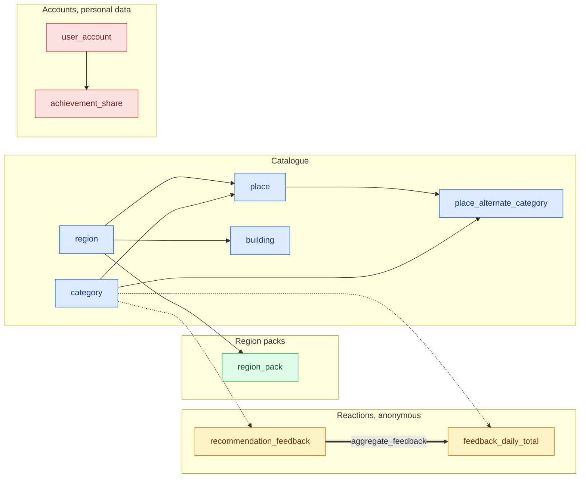
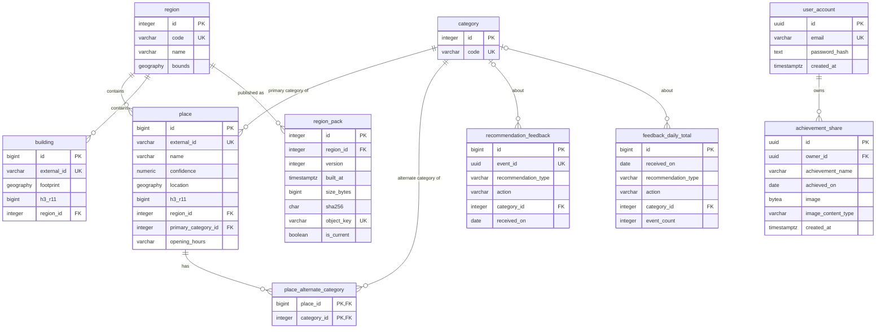

# Data dictionary

Unwalked keeps data in two places. Movement history never leaves the phone. It lives in an on-device Room (SQLite) database. The server runs PostgreSQL 17 with PostGIS 3.5. It stores the shared place and building catalogue, the downloadable region packs, accounts used only for sharing achievements, and anonymous reactions to recommendations.

The server schema is created by EF Core migrations in `src/Unwalked.Infrastructure/Persistence/Migrations`. The same DDL as a plain SQL script is in [db/schema.sql](../../db/schema.sql).

## Logical schema

The schema has four blocks. The catalogue and the packs are public reference data loaded by scripts. Accounts hold the only personal data on the server. Reactions are anonymous and flow from raw rows into daily totals.

Dashed lines are optional links. The thick line is the aggregation procedure. Columns, keys and cardinalities are in the diagram below.

## Normalisation

The schema is in third normal form. Every non-key column depends on the whole key and only on it.

| Decision | Why |
|---|---|
| Categories are a reference table | A place has one primary category and any number of alternate ones. Storing codes inline would repeat the same string thousands of times and allow typos. |
| Alternate categories are a separate link table | A list column would break the first normal form. |
| Regions are a reference table | Places, buildings and region packs all belong to a region. The region name and bounds are stored once. |
| A place has no `building_id` | The building of a place follows from its location and the building footprint. Storing it would duplicate a fact that geometry already gives and could drift when either catalogue is reloaded. |
| `recommendation_type` and `action` stay as checked text | They are closed sets fixed by the API contract. A lookup table would add joins and no new facts. The `CHECK` constraints keep them valid. |
| `feedback_daily_total` repeats the shape of `recommendation_feedback` | It is a deliberate summary table, not a copy. Raw rows are moved into it, so each reaction is counted exactly once. |

## Integrity and transactions

Integrity is enforced by the database itself, so a bug in the API or a manual query cannot store an invalid row.

| Rule | How |
|---|---|
| Every row is identified | Primary key on every table, natural keys such as `region.code`, `place.external_id` and `user_account.email` are unique |
| References stay valid | Foreign keys on every link. Catalogue links use `RESTRICT`, so a category or region in use cannot be removed. Data owned by an account uses `CASCADE`, so deleting the account removes its cards. Reactions use `SET NULL` on category, so a retired category keeps the counts |
| Values make sense | `CHECK` constraints on formats, ranges and closed lists: lowercase email, confidence between 0 and 1, positive pack size and version, a fixed set of recommendation types and actions, valid building footprints, non-blank names |
| One current pack per region | Partial unique index `ux_region_pack_current` plus the trigger that retires the previous pack |
| A reaction is counted once | Unique `event_id`. The phone resends the same id after a network error, and the API treats the duplicate as success |
| One email, one account | Unique `user_account.email`. A race between two sign-ups ends with one account and a conflict for the other |

Transactions follow the unit of work.

| Operation | Transaction |
|---|---|
| One API request | One `SaveChanges` call, a single transaction at Read Committed, the PostgreSQL default |
| Account deletion | One statement, cards go with it through the cascade |
| `aggregate_feedback` | One statement that deletes raw reactions and upserts the daily totals, so a reaction is either raw or counted, never both or neither |
| Seed scripts | All scripts of a folder run in one transaction. A failing script leaves the database as it was |
| Catalogue load | Places and their alternate categories are copied in one transaction, so a region is never half loaded |

## Data quality expectations

| Table | Expectation | Checked by |
|---|---|---|
| `category` | Codes match the Overture taxonomy, lowercase with underscores | `CHECK`, reference seed |
| `region` | Code is lowercase, name is not blank, bounds cover every place of the region | `CHECK`, catalogue loader |
| `place` | Name is not blank, confidence between 0 and 1, location inside the region, primary category known | `CHECK`, foreign keys, catalogue loader |
| `building` | Footprint is a valid polygon, external id is unique | `CHECK`, unique index |
| `region_pack` | Version is positive and unique within the region, one current pack per region, size is positive, `sha256` is 64 lowercase hex characters | `CHECK`, unique indexes, trigger |
| `user_account` | Email is lowercase and unique, password is stored only as a hash | `CHECK`, unique index, API |
| `recommendation_feedback` | Type and action from the fixed list, date has day precision, no coordinates and no account | `CHECK`, schema has no such columns |
| `feedback_daily_total` | Count is positive, one row per day, type, action and category | `CHECK`, unique index |

Rows that break an expectation are rejected, not repaired. The catalogue loader skips such rows and reports how many it skipped.

## Server tables

### region

A city or area for which the catalogue and a region pack are built.

| Column | Type | Null | Description |
|---|---|---|---|
| id | integer identity | no | Primary key |
| code | varchar(32) | no | Stable slug used in URLs and object keys, for example `vilnius`. Unique, lowercase letters, digits and hyphens |
| name | varchar(100) | no | Display name. Must not be blank |
| bounds | geography(polygon, 4326) | no | Area covered by the catalogue |

### region_pack

A built offline package of tiles and places for one region. The phone downloads the current one.

| Column | Type | Null | Description |
|---|---|---|---|
| id | integer identity | no | Primary key |
| region_id | integer | no | Region, `ON DELETE RESTRICT` |
| version | integer | no | Increasing build number, positive, unique per region |
| built_at | timestamptz | no | Build time |
| size_bytes | bigint | no | Download size, positive |
| sha256 | char(64) | no | Lowercase hex checksum the phone verifies after download |
| object_key | varchar(200) | no | Path of the pack file published as a GitHub release asset, such as `packs/vilnius/v2.pack`. The download URL is built from it. Unique |
| is_current | boolean | no | The pack offered to phones. At most one per region |

### category

Overture Places category codes. Filled by the reference seed.

| Column | Type | Null | Description |
|---|---|---|---|
| id | integer identity | no | Primary key |
| code | varchar(64) | no | Overture code such as `cafe`. Unique, lowercase letters, digits and underscores |

### place

A point of interest from Overture Places (CDLA-Permissive 2.0).

| Column | Type | Null | Description |
|---|---|---|---|
| id | bigint identity | no | Primary key |
| external_id | varchar(64) | no | Overture identifier. Unique, used to reload without duplicates |
| name | varchar(300) | no | Primary name. Must not be blank |
| confidence | numeric(4,3) | no | Overture existence confidence from 0 to 1 |
| location | geography(point, 4326) | no | Coordinates |
| h3_r11 | bigint | no | H3 cell at resolution 11 that contains the place |
| region_id | integer | no | Region, `ON DELETE RESTRICT` |
| primary_category_id | integer | no | Main category, `ON DELETE RESTRICT` |
| opening_hours | varchar(255) | yes | Opening hours in OpenStreetMap `opening_hours` syntax, for example `Mo-Fr 08:00-20:00`. Taken from OSM (ODbL) where a matching object exists. Null when unknown, never blank |

### building

A building footprint from Overture Buildings, which is mostly derived from OpenStreetMap (ODbL). The phone uses footprints to decide which building a stay happened in.

| Column | Type | Null | Description |
|---|---|---|---|
| id | bigint identity | no | Primary key |
| external_id | varchar(64) | no | Overture identifier. Unique, used to reload without duplicates |
| footprint | geography(multipolygon, 4326) | no | Outline of the building. Must be a valid geometry |
| h3_r11 | bigint | no | H3 cell at resolution 11 that contains the centroid. Used to split footprints into pack buckets |
| region_id | integer | no | Region, `ON DELETE RESTRICT` |

### place_alternate_category

Additional categories of a place.

| Column | Type | Null | Description |
|---|---|---|---|
| place_id | bigint | no | Part of the primary key. Place, `ON DELETE CASCADE` |
| category_id | integer | no | Part of the primary key. Category, `ON DELETE RESTRICT` |

### user_account

An account exists only to publish achievement cards. It holds no location data.

| Column | Type | Null | Description |
|---|---|---|---|
| id | uuid | no | Primary key |
| email | varchar(254) | no | Login. Unique, stored in lowercase. Personal data |
| password_hash | text | no | ASP.NET Core Identity v3 hash (PBKDF2-HMAC-SHA512, 100 000 iterations). Never returned by the API |
| created_at | timestamptz | no | Registration time |

### achievement_share

A rendered achievement card published by its owner. The image is produced on the phone with the home area already blurred.

| Column | Type | Null | Description |
|---|---|---|---|
| id | uuid | no | Primary key, also the public link id |
| owner_id | uuid | no | Owner, `ON DELETE CASCADE`, so deleting an account removes its cards |
| achievement_name | varchar(80) | no | Title shown on the card. Must not be blank |
| achieved_on | date | no | Date the achievement was earned |
| image | bytea | no | Card image, 1 byte to 300 KB |
| image_content_type | varchar(32) | no | `image/png`, `image/jpeg` or `image/webp` |
| created_at | timestamptz | no | Publication time |

### recommendation_feedback

One anonymous reaction to a recommendation, used for the research part of the thesis. It has no link to an account or a location.

| Column | Type | Null | Description |
|---|---|---|---|
| id | bigint identity | no | Primary key |
| event_id | uuid | no | Id generated on the phone. Unique, so a retried request is stored once |
| recommendation_type | varchar(32) | no | `nearby_new_place`, `along_habitual_route`, `unvisited_cell` or `walking_route` |
| action | varchar(16) | no | `accepted`, `dismissed` or `visited` |
| category_id | integer | yes | Category of the recommended place, `ON DELETE SET NULL` |
| received_on | date | no | Day only, no time, to avoid linking reactions to sessions |

### feedback_daily_total

Daily counts of reactions older than the retention window. The `aggregate_feedback` procedure fills it.

| Column | Type | Null | Description |
|---|---|---|---|
| id | bigint identity | no | Primary key |
| received_on | date | no | Day |
| recommendation_type | varchar(32) | no | Same values as in `recommendation_feedback` |
| action | varchar(16) | no | Same values as in `recommendation_feedback` |
| category_id | integer | yes | Category, `ON DELETE SET NULL` |
| event_count | integer | no | Number of reactions, positive |

The combination of day, type, action and category is unique, with `NULLS NOT DISTINCT`, so reactions without a category also land in a single row.

## Indexes

| Index | Purpose |
|---|---|
| `ix_place_location` (GiST) | Radius and box search for places. Used by the pack builder and service queries, the app searches its own copy of the pack |
| `ix_place_h3_r11` | Places inside the H3 cells of a route or an unvisited area |
| `ix_building_footprint` (GiST) | Building that contains or is nearest to a point |
| `ix_building_h3_r11` | Footprints of one H3 bucket when a region pack is built |
| `ix_place_alternate_category_category_id_place_id` | Filter places by category |
| `ix_recommendation_feedback_received_on_recommendation_type` | Statistics for a date range |
| `ux_region_pack_current` (partial, `WHERE is_current`) | Guarantees one current pack per region |
| `ux_feedback_daily_total_day_type_action_category` (`NULLS NOT DISTINCT`) | Target of the upsert in `aggregate_feedback` |
| Unique indexes on natural keys | `region.code`, `category.code`, `place.external_id`, `building.external_id`, `user_account.email`, `recommendation_feedback.event_id`, `region_pack.object_key`, `region_pack (region_id, version)` |
| Indexes on foreign keys | Fast cascades and joins |

## Views

| View | Readable by | Content |
|---|---|---|
| `v_region_pack_index` | `app_read` | Current pack of every region with the region code, name and bounds |
| `v_place_detail` | `app_read` | Place with its region code, primary category code and opening hours |
| `v_user_account_masked` | `app_analyst` | Accounts with a masked email such as `o***@example.test` and the number of published cards. Created with `security_barrier` |
| `v_feedback_summary` | `app_analyst` | Reaction counts by type and action, raw and aggregated together |

## Functions, triggers and procedures

| Object | Kind | Behaviour |
|---|---|---|
| `mask_email(text)` | SQL function | Keeps the first letter and the domain, hides the rest |
| `trg_region_pack_retire_previous` | `BEFORE INSERT OR UPDATE OF is_current` trigger | When a pack becomes current, the previous current pack of the same region stops being current. A repeated insert of an existing version is left alone, so an idempotent seed keeps the current pack |
| `aggregate_feedback(cutoff date)` | Procedure | Moves reactions received before `cutoff` into daily totals in one statement and adds to existing counts |

## Roles

The application never connects as a superuser or as the schema owner. Each login gets only the group role it needs.

| Role | Login | Rights |
|---|---|---|
| `unwalked_migrator` | yes | Member of `admin`. Creates and owns the tables, runs migrations, seeds and the catalogue loader |
| `app_read` | no | `SELECT` on catalogue, building, region, pack, account, share and feedback tables and the API views |
| `app_write` | no | Member of `app_read`. `INSERT`, `DELETE` on `user_account` and `achievement_share`, `INSERT` on `recommendation_feedback` |
| `unwalked_api` | yes | Member of `app_write`. Used by the API |
| `app_analyst` | no | `SELECT` on `category`, `recommendation_feedback`, `feedback_daily_total`, `v_feedback_summary` and `v_user_account_masked`. No access to `user_account`, `achievement_share`, `place` or `building` |
| `unwalked_analyst` | yes | Member of `app_analyst`. Used for research queries |
| `admin` | no | Full rights on the schema |

Nobody but the migrator can run `aggregate_feedback` or change region packs. Integration tests check that the API and analyst logins get `insufficient_privilege` there.

## Personal data

| Data | Where | Protection |
|---|---|---|
| Location history | Phone only | Never sent to the server |
| Stay matches and Wi-Fi fingerprints | Phone only | Never sent to the server. Access point identifiers are stored as salted hashes |
| Email | `user_account.email` | Hidden from analysts by `v_user_account_masked`, removed with the account |
| Password | `user_account.password_hash` | Salted PBKDF2 hash, never readable by analysts |
| Achievement card | `achievement_share.image` | Home area blurred on the phone before upload, removed with the account |
| Reactions | `recommendation_feedback` | No account, no coordinates, day precision, aggregated after the retention window |

## Seed data

| Folder | Content | When |
|---|---|---|
| `db/seed/reference` | 809 Overture category codes and the Vilnius region | Every environment, after migrations |
| `db/seed/test` | Three test accounts with the password `Unwalked-test-1`, three achievement cards, 80 reactions for October and November 2026, two Vilnius packs | Local development and demos only |

Every script can run again without creating duplicates.

The test data covers the cases the API and the reports must handle.

| Case | Data |
|---|---|
| Account with several cards, with one card, with none | `ona`, `jonas`, `rasa` |
| Reaction without a category | 10 of 80 reactions |
| Every action | 34 accepted, 33 dismissed, 13 visited |
| Range across two months and the aggregation cutoff | 1 October to 8 November 2026 |
| Old and current pack of one region | Vilnius v1 and v2 |

## On-device database (Room)

Room keeps the raw movement data and everything derived from it. Tables marked as planned are part of the design and will be added during client development.

### point

A raw location fix.

| Column | Type | Null | Description |
|---|---|---|---|
| id | INTEGER | no | Primary key, auto-generated |
| time | INTEGER | no | Fix time, Unix milliseconds. Indexed |
| lat | REAL | no | Latitude, WGS 84 |
| lon | REAL | no | Longitude, WGS 84 |
| accuracy | REAL | no | Horizontal accuracy in metres |
| source | TEXT | no | Provider: fused location, GPX simulator or import |

### stay

A place where the person stayed for a while, detected from consecutive points.

| Column | Type | Null | Description |
|---|---|---|---|
| id | INTEGER | no | Primary key, auto-generated |
| start | INTEGER | no | Start, Unix milliseconds |
| end | INTEGER | no | End, Unix milliseconds |
| lat | REAL | no | Centre latitude |
| lon | REAL | no | Centre longitude |
| points | INTEGER | no | Number of fixes that formed the stay |
| source | TEXT | no | Detection method |
| radius | REAL | no | Planned. Radius in metres that holds most fixes of the stay, at least the median accuracy |
| buildingId | INTEGER | yes | Planned. `building.id` from the installed pack chosen for the stay |
| placeId | INTEGER | yes | Planned. `place.id` from the installed pack chosen for the stay |
| confidence | REAL | yes | Planned. Score of the chosen candidate from 0 to 1 |
| confirmed | INTEGER | no | Planned. 1 when the person confirmed or corrected the match, otherwise 0 |

### cell

Visit statistics per H3 cell, the basis of the heat map and of novelty.

| Column | Type | Null | Description |
|---|---|---|---|
| h3 | INTEGER | no | H3 index. Part of the primary key |
| resolution | INTEGER | no | H3 resolution, 11 or 12. Part of the primary key |
| passes | INTEGER | no | Number of separate passes through the cell |
| firstSeen | INTEGER | no | First visit, Unix milliseconds |
| lastSeen | INTEGER | no | Last visit, Unix milliseconds |

### health

Diagnostic log of the background collection service, kept to debug Doze and vendor process killers.

| Column | Type | Null | Description |
|---|---|---|---|
| id | INTEGER | no | Primary key, auto-generated |
| time | INTEGER | no | Event time, Unix milliseconds. Indexed |
| type | TEXT | no | Event kind, for example service start, stop or permission change |
| detail | TEXT | no | Free text |

### Planned tables

| Table | Purpose |
|---|---|
| `installed_pack` | Region pack on the phone: region code, version, checksum, install time |
| `recommendation` | Recommendations shown to the person, with type, target and the reaction, kept until the reaction is sent |
| `achievement` | Earned achievements with the date and whether the card was shared |
| `home_zone` | Area blurred on shared cards |
| `stay_candidate` | Buildings and places that could explain a stay, see below |
| `wifi_print` | Wi-Fi fingerprint of a stay, see below |

### stay_candidate (planned)

One possible explanation of a stay. Several rows are kept per stay, so a correction can pick another one without a new search.

| Column | Type | Null | Description |
|---|---|---|---|
| stayId | INTEGER | no | Stay, part of the primary key, deleted with the stay |
| kind | TEXT | no | `place` or `building`, part of the primary key |
| targetId | INTEGER | no | `place.id` or `building.id` from the installed pack, part of the primary key |
| score | REAL | no | Combined score from 0 to 1 |
| rank | INTEGER | no | Position in the list shown to the person, starting at 1 |

### wifi_print (planned)

Access points seen during a stay. A later stay with a similar set is matched to the same place without GPS.

| Column | Type | Null | Description |
|---|---|---|---|
| stayId | INTEGER | no | Stay, part of the primary key, deleted with the stay |
| bssidHash | TEXT | no | Salted SHA-256 of the access point MAC address, part of the primary key. The salt never leaves the phone |
| rssi | INTEGER | no | Strongest signal level seen, dBm |

## Matching a stay to a building and a place

The phone works out where a stay happened without sending anything to the server. The installed region pack already holds the places, their opening hours and the building footprints of the area, bucketed by H3 resolution 11 cell.

1. Candidates are every building whose footprint lies within the stay radius plus 30 metres, and every place inside those buildings or within the same distance.
2. Each candidate gets a score from the distance to the stay centre, the overlap of the stay circle with the footprint, whether the place was open during the stay, how well the duration and time of day fit the category, the activity before the stay (a long walk ending at a stop suggests a shop rather than an office), and the confidence from Overture.
3. Previous stays of the same person count most. A Wi-Fi fingerprint that matches a confirmed stay, or a candidate the person already confirmed nearby, raises the score sharply.
4. The best candidate is stored on the stay. When its score is low or two candidates are close, the app asks the person to choose. The answer sets `confirmed`, and later stays near it inherit the choice.
5. Repeated long night stays and repeated weekday stays are recognised as home and work. They are kept out of recommendations and blurred on shared cards.

A building without a named place is still a valid answer. The stay then counts towards the heat map and novelty but not towards place statistics.

## Choice of database

| Requirement | Choice |
|---|---|
| Spatial queries on places and buildings: radius, containment, nearest | PostgreSQL with PostGIS. The `geography` type works in metres on the sphere, and GiST indexes serve the queries above |
| Integrity of a shared catalogue | Foreign keys, check constraints, unique natural keys and roles with least privilege are native in PostgreSQL |
| Free hosting for the thesis | Managed PostgreSQL with PostGIS is available on free tiers, and the same image runs in Docker for development and tests |
| Movement history stays on the phone | Room over SQLite. It works offline, needs no server and keeps the most sensitive data out of the backend |

Document stores such as MongoDB were rejected because the catalogue is relational and its spatial support is limited to simpler queries. SpatiaLite on the server was rejected because it lacks roles and concurrent writers.

## Schema versioning

The schema changes only through EF Core migrations in `src/Unwalked.Infrastructure/Persistence/Migrations`. Each migration is a class with a timestamp, so the order is fixed and the history lives in Git. Views, the trigger, the procedure and role grants are written as SQL inside migrations, so they are versioned the same way as tables.

A migration that adds a table or a view also grants rights on it to the right group role. `db/schema.sql` is regenerated from the migrations after every change and is never edited by hand.

Applied migrations are recorded in `__EFMigrationsHistory`. Running `migrate` again applies only the missing ones.
